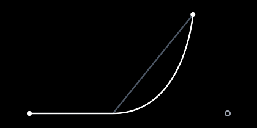

# Curves
This guide will show you how to move along curves instead of straight lines, and how to change a target while a tween plays without the motion kinking.

## Bezier curves

A `BezierTween` goes from one value to another along a curve that bends toward a control point:

```csharp
var arc = new BezierTween<Vector2>(new Vector2(100, 400), new Vector2(300, 0), new Vector2(500, 400), 800, Easing.SineInOut);
```


The curve doesn't go through the control point. It starts by heading toward it, then turns to reach the end. With two control points, the curve leaves toward the first one and arrives from the second one:

```csharp
var swoop = new BezierTween<Vector2>(start, start + new Vector2(0, -200), end + new Vector2(0, -200), end, 800, Easing.CubeInOut);
```


The easing is how fast it moves along the curve, not the shape of the curve.

`CurveTo` chains a curve from where the previous tween ended:

```csharp
var position = new Vector2Tween(new Vector2(100, 400), new Vector2(200, 400), 300, Easing.Linear)
    .CurveTo(new Vector2(400, 100), new Vector2(500, 400), 800, Easing.SineOut)
    .To(new Vector2(600, 400), 300, Easing.Linear);
```

A Bezier curve only needs a lerp, so it works with every type that `Tween<T>` works with, including `Color` and your own types.

## Splines

A `SplineTween` goes through each point along a smooth curve:

```csharp
var points = new[] {
    new Vector2(100, 300),
    new Vector2(250, 150),
    new Vector2(400, 300),
    new Vector2(550, 150),
};

var path = new SplineTween<Vector2>(points, 2000, Easing.Linear);
```


Each point to the next takes the same time, so the tween goes faster where the points are far apart. The easing applies to the whole spline, so with `Easing.SineInOut` it starts and stops slowly but doesn't stop at each point.

You can also say when to reach each point, in milliseconds from the start:

```csharp
var path = new SplineTween<Vector2>(points, new double[] { 0, 300, 1200, 1500 });
```

Each time comes after the one before. If the first time isn't 0, the tween holds the first point until then.

`SplineTo` chains a spline from where the previous tween ended:

```csharp
var flight = new Vector2Tween(new Vector2(0, 300), new Vector2(100, 300), 200, Easing.Linear)
    .SplineTo(points, 2000, Easing.Linear);
```

The spline goes through the points, so it needs to add, subtract and scale values. It works on `float`, `Vector2`, `Vector3` and `Vector4`. [Custom types](../custom-types/README.md) shows how to add that math for your own types.

## Velocity

`VelocityAt` tells you how fast a tween's value changes at some point, in units per millisecond:

```csharp
Vector2 velocity = path.VelocityAt(500);
```

A player's `Velocity` is the velocity at its current time. It's 0 before the tween starts and after it ends. For example, to point a ship in the direction it's moving:

```csharp
Vector2 velocity = _position.Velocity;
if (velocity != Vector2.Zero) {
    _rotation = MathF.Atan2(velocity.Y, velocity.X);
}
```

## Retarget

Let's say a camera follows the player and the player moves while the camera is still on its way. Playing a new tween from the current value works, but the camera changes speed and direction all at once, which makes a kink in the motion. `Retarget` starts from the current value at the current velocity instead, then slows down to a stop on the new target:

```csharp
if (target != _lastTarget) {
    _camera.Retarget(target, 400);
    _lastTarget = target;
}
```



The value heads for the target on the right. Partway, the target moves up. The gray path is a new tween from the current value while the white path is `Retarget`.

`Retarget` replaces the player's tween with a `HermiteTween` and restarts it. A `HermiteTween` goes from one value to another, leaving and arriving at the velocities you give it:

```csharp
var toss = new HermiteTween<Vector2>(start, new Vector2(0.5f, -1f), end, Vector2.Zero, 600);
```

A fast start velocity with a short duration can overshoot the target before settling on it.
