# Easing
This guide shows the easing functions that come with the library.

An easing function shapes the motion of a tween. It takes the progress of the tween from 0 to 1 and returns how far along the value should be. Most of them come in three versions:

* `In` starts slow and speeds up.
* `Out` starts fast and slows down.
* `InOut` starts slow, speeds up in the middle, then slows down.

In the images below, time goes from left to right. The bottom line is the start value and the top line is the end value.

Pass the one you want when you create a tween:

```csharp
var position = new Vector2Tween(new Vector2(100, 100), new Vector2(500, 100), 1000, Easing.CubeOut);
```

`Out` is a good default for things that react to the player since the motion starts right away. `InOut` works well for something going from one place to another.

## Linear

`Easing.Linear` moves at the same speed the whole way.

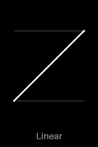

## Sine

`Easing.SineIn`, `Easing.SineOut`, `Easing.SineInOut`. The softest curve.

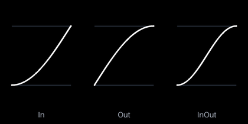

## Quad

`Easing.QuadIn`, `Easing.QuadOut`, `Easing.QuadInOut`. The progress is squared.

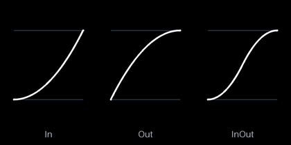

## Cube

`Easing.CubeIn`, `Easing.CubeOut`, `Easing.CubeInOut`. The progress is cubed.

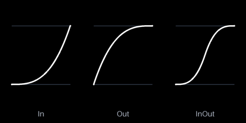

## Quart

`Easing.QuartIn`, `Easing.QuartOut`, `Easing.QuartInOut`. The progress to the power of 4.

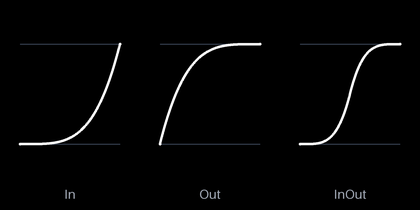

## Quint

`Easing.QuintIn`, `Easing.QuintOut`, `Easing.QuintInOut`. The progress to the power of 5.

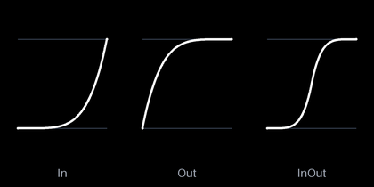

## Expo

`Easing.ExpoIn`, `Easing.ExpoOut`, `Easing.ExpoInOut`. The sharpest of the curves, it barely moves at the slow end.

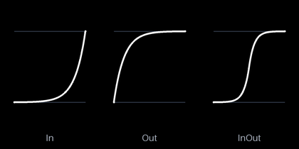

## Circ

`Easing.CircIn`, `Easing.CircOut`, `Easing.CircInOut`. A quarter of a circle. The fast end is vertical, so the motion stops or starts instantly.

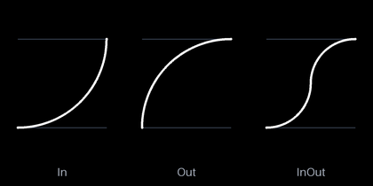

## Back

`Easing.BackIn`, `Easing.BackOut`, `Easing.BackInOut`. `In` pulls back before it goes and `Out` goes past the end before it settles.

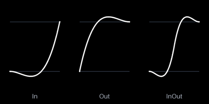

## Elastic

`Easing.ElasticIn`, `Easing.ElasticOut`, `Easing.ElasticInOut`. Swings around the end value like a spring.

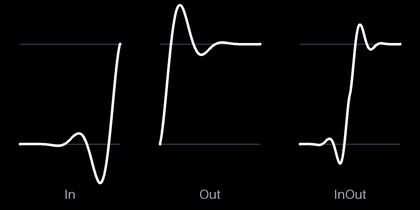

## Bounce

`Easing.BounceIn`, `Easing.BounceOut`, `Easing.BounceInOut`. Bounces against the end value like a ball hitting the floor.

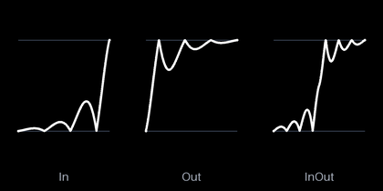

Elastic and Bounce aren't the exact curves from [easings.net](https://easings.net). They're simpler ones that feel the same.

## Going past the end

Back and Elastic go past the start and end values. A `Vector2Tween` or `FloatTween` follows them, while a `ColorTween` stops at the two colors.

## Your own

An easing function is any method that takes a `float` and returns a `float`. It should return 0 at 0 and 1 at 1. If it doesn't, the value jumps at the start or at the end of the tween:

```csharp
var position = new Vector2Tween(new Vector2(100, 100), new Vector2(500, 100), 1000, x => x * x * x * x * x * x);
```

## Follow up

[Time](../time/README.md), a guide that shows how to delay, restart, pause and slow down tweens.
