# Sequences
This guide will show you how to chain tweens to make longer animations.

Every tween can be followed by another one. The methods below each return a new tween, so you can keep chaining:

```csharp
var position = new Vector2Tween(new Vector2(50, 50), new Vector2(200, 200), 2000, Easing.SineIn)
    .Wait(1000)
    .Offset(new Vector2(-100, 0), 500, Easing.BounceOut)
    .Yoyo()
    .Loop();
```

The whole chain is a single tween. You play it like any other:

```csharp
_position = position.Play();
```

In the images below, time goes from left to right. The bottom line is 0 and the top line is 1.

## To

`To` goes from where the previous tween ended to a new value:

```csharp
var height = new FloatTween(0f, 1f, 1000, Easing.SineInOut)
    .To(0.3f, 1000, Easing.BounceOut);
```

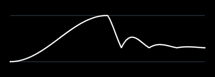

## Offset

`Offset` moves by an amount from where the previous tween ended:

```csharp
var height = new FloatTween(0f, 0.4f, 800, Easing.CubeOut)
    .Offset(0.4f, 800, Easing.CubeOut)
    .Offset(-0.6f, 800, Easing.CubeOut);
```

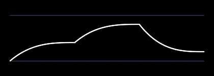

On a `ColorTween`, the offset is a `Vector4` in the 0 to 1 range of `Color.ToVector4()`. It can be negative to take color away.

## Wait

`Wait` holds the end value of the previous tween for some time:

```csharp
var height = new FloatTween(0f, 1f, 1000, Easing.SineInOut)
    .Wait(800)
    .To(0f, 1000, Easing.SineInOut);
```

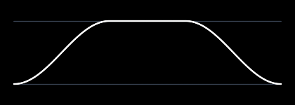

## Then

`Then` plays any tween after another. `To`, `Offset` and `Wait` are built on it:

```csharp
var height = new FloatTween(0f, 1f, 1000, Easing.SineInOut)
    .Then(new FloatTween(1f, 0.3f, 1000, Easing.BounceOut));
```

The second tween starts when the first one ends. It doesn't need to start where the first one ended. If it doesn't, the value jumps from one to the other.

## Reverse

`Reverse` plays a tween backward:

```csharp
var height = new FloatTween(0f, 1f, 1000, Easing.QuadIn).Reverse();
```

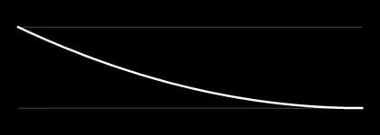

## Yoyo

`Yoyo` plays a tween forward, then backward to where it started:

```csharp
var height = new FloatTween(0f, 1f, 1000, Easing.QuadIn).Yoyo();
```

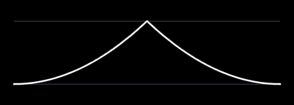

## Loop

`Loop` plays a tween over and over, forever:

```csharp
var height = new FloatTween(0f, 1f, 600, Easing.QuadOut).Yoyo().Loop();
```

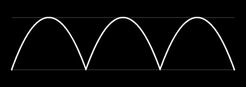

You can also give it the number of times to play. After the last time, it stays on the end value. A count like `2.5` stops halfway through the third time:

```csharp
var height = new FloatTween(0f, 1f, 800, Easing.SineInOut)
    .Wait(300)
    .Loop(3);
```

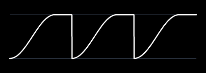

A loop that never ends has a `Duration` of `double.PositiveInfinity`. Anything you chain after it never plays, so `Loop()` usually goes last.

## Speed

`Speed` plays a tween faster or slower. 2 is twice as fast and 0.5 is half as fast:

```csharp
var height = new FloatTween(0f, 1f, 1000, Easing.SineInOut).Yoyo().Speed(2);
```

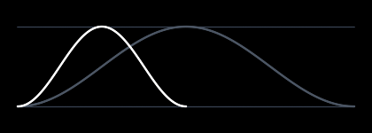

The gray curve is the same yoyo without `Speed`. The yoyo plays the 1000 millisecond tween forward and back, so it lasts 2000 milliseconds. Twice as fast, the white one lasts 1000.

## Delay

`Delay` holds the start value for some time, then plays the tween:

```csharp
var height = new FloatTween(0f, 1f, 1000, Easing.SineInOut).Delay(500);
```

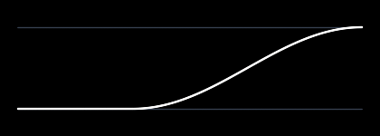

## Slice

`Slice` plays part of a tween, from a start time to an end time in milliseconds:

```csharp
var bounce = new FloatTween(0f, 1f, 1000, Easing.BounceOut);
var lastBounces = bounce.Slice(500, 1000);
```

It also gives an end to a loop that never ends. This one goes up and down 3 and a half times:

```csharp
var height = new FloatTween(0f, 1f, 300, Easing.QuadOut).Yoyo().Loop().Slice(0, 2100);
```

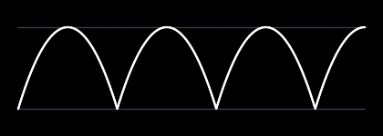

## Remap

`Remap` plays a tween on a time of your own. You give it a duration and a function that takes the milliseconds from 0 to that duration and returns when to read the tween. For example, to play a tween backward at half speed:

```csharp
var tween = new FloatTween(0f, 1f, 1000, Easing.QuadIn);
var slowReverse = tween.Remap(2000, ms => 1000 - ms / 2);
```

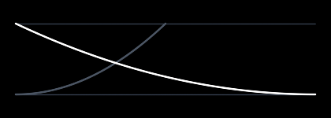

The gray curve is the same tween without `Remap`.

`Speed`, `Delay`, `Slice`, `Reverse` and `Yoyo` could all be written with `Remap`.

## Changing a chain

A tween never changes once it's created. Each method returns a new one and leaves the old one as it was, so you can start a few tweens from the same one:

```csharp
var rise = new FloatTween(0f, 1f, 300, Easing.QuadOut).Wait(500);
var fall = rise.To(0f, 300, Easing.QuadIn);
var drop = rise.To(-1f, 600, Easing.BounceOut);
```

`rise` is still 800 milliseconds long and ends on 1. Chaining onto the newest tween only adds a step at the end, so chains with thousands of steps are quick to build. Chaining onto an older one, like `fall` and `drop` do, copies the steps before it.

To change what a player plays, give it a new tween. It keeps its start time:

```csharp
_height.Tween = rise.To(0.5f, 300, Easing.QuadIn);
```

For a value that eases toward a target that keeps changing, like a scroll offset, an `EasedValue` is easier. [Moving targets](../targets/README.md) shows how to use it.

## Follow up

[Easing](../easing/README.md), a page that shows every easing function.
