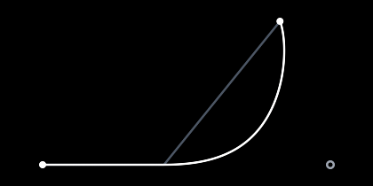

# Moving targets
This guide will show you how to ease toward a target that keeps changing, like a scroll offset, a hover glow or a camera that follows the player.

## EasedValue

Let's say a list scrolls with the mouse wheel. Each notch moves the target a bit further, often before the last move is done. An `EasedValue` holds the value and where it's going:

```csharp
EasedValue<float> _scroll = new EasedValue<float>(0f, 300, Easing.ExpoOut);
```

The arguments are the start value, how long each move takes in milliseconds, and the easing of each move. Setting `Target` starts a move from wherever the value is right now:

```csharp
if (scrolled) {
    _scroll.Target += scrollDelta * 40f;
}
```

Then read `Value` where you need it:

```csharp
float offset = _scroll.Value;
```

`Target` is where the value is going, so `+=` adds to the end of the move instead of to where the value is now. Two quick notches scroll twice as far.

Setting the target it already has does nothing, so you can set it every frame:

```csharp
_glow.Target = hovered ? 1f : 0f;
```

`Snap` jumps right away, for example while a drag follows the pointer:

```csharp
_scroll.Snap(dragOffset);
```

`IsDone` tells you when the value reached its target. Changing the target doesn't allocate, so it's fine to have one for every button in a UI. Like a player, an `EasedValue` reads its time from `TweenHelper.Clock` unless you give it another [clock](../time/README.md).

## Duration

The duration can also depend on how far the value has to go. This one moves 2 units per millisecond and never takes more than 400 milliseconds:

```csharp
var scroll = new EasedValue<float>(0f, (from, to) => Math.Min(Math.Abs(to - from) / 2f, 400), Easing.ExpoOut);
```

`Duration` and `Easing` can be changed at any time. The move that's playing keeps going the way it was, and the next one uses them.

## Smooth

Each move starts from the current value, but at the speed its easing starts with. When the target changes in the middle of a move, the speed and direction change all at once. `Smooth` keeps the velocity the value had and lets it fade out over the move instead:

```csharp
var camera = new EasedValue<Vector2>(start, 1000, Easing.SineInOut) { Smooth = true };
```



The value heads for the target on the right. Partway, the target moves up. The gray path is without `Smooth` while the white path is with it.

With an easing that starts at rest, like `SineInOut`, the speed doesn't jump at all. With an easing that starts fast, like `ExpoOut`, each move adds its speed to the speed the value already had, so a few quick wheel notches in a row make the scroll go faster.

`Smooth` needs to add, subtract and scale values, so it works on `float`, `Vector2`, `Vector3` and `Vector4`. [Custom types](../custom-types/README.md) shows how to add that math for your own types. Without `Smooth`, an `EasedValue` only needs a lerp, so it also works on `Color`.

## Velocity

`VelocityAt` tells you how fast a tween's value changes at some point, in units per millisecond:

```csharp
Vector2 velocity = path.VelocityAt(500);
```

Players and eased values have a `Velocity` too, for the current time. It's 0 when the value isn't moving. For example, to point a ship in the direction it's moving:

```csharp
Vector2 velocity = _position.Velocity;
if (velocity != Vector2.Zero) {
    _rotation = MathF.Atan2(velocity.Y, velocity.X);
}
```

## Retarget

An `EasedValue` only ever goes toward a target. When a player plays other tweens too, like a bounce, `Retarget` does what `Smooth` does. It replaces the player's tween with a move from the current value at the current velocity, and restarts it:

```csharp
_camera.Retarget(target, 1000, Easing.SineInOut);
```

Without an easing, it slows down to a stop on the target along a `HermiteTween`. A `HermiteTween` goes from one value to another, leaving and arriving at the velocities you give it:

```csharp
var toss = new HermiteTween<Vector2>(start, new Vector2(0.5f, -1f), end, Vector2.Zero, 600);
```

A fast start velocity with a short duration can overshoot the target before settling on it.
